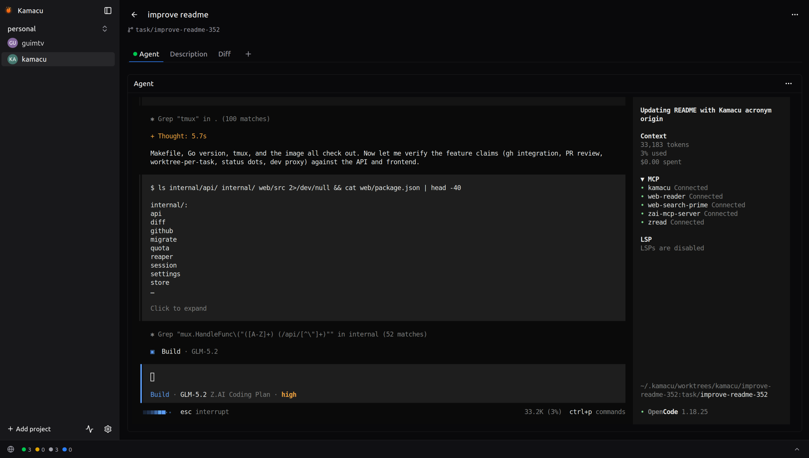

# Kamacu

A local-only, agent-agnostic web app for organizing coding-agent sessions around
projects and tasks. Claude Code, OpenCode and Codex are supported natively, and any
other terminal-driven agent can be added as a custom agent. The name is an acronym:
**KA**nban **M**ulti-**A**gent **C**ontrol **U**nit —
Kamacu is the control unit that drives your kanban of parallel agents, and the
ember-spark logo is that animating force made visible.



## What it is

A left sidebar lists your projects, each pointing at a local git repo checkout. The main
area is a kanban board of tasks. Click a task to expand a full-page view with the main
agent session — the agent's real CLI running in a PTY, rendered live in a browser
terminal — plus optional tabs for extra bash sessions. Claude Code, OpenCode and Codex
are built in, with live working/idle/waiting status on the board; any other CLI agent
can be registered as a custom agent from just a name and a command. The default agent is
configurable per project.

It runs entirely on your machine, single user, accessed from a browser at localhost. The
whole point is one place to see and drive all your agent work: every task gets its own
isolated git worktree and a persistent agent session you can open, leave, and
reattach to from any browser tab.

Click the **?** on the right of the bottom sessions bar to ask **What's pending?**
across the current project, the current workspace, or all workspaces. The dialog
starts with the current workspace, both In Review and In Progress cards, and
both active and closed terminals. Working agents, waiting agents with pending
Inbox messages, snoozed cards, and terminals containing drafts or choice dialogs
are skipped. Closed terminals resume only when
a previous conversation is available, and remain open afterward.

Checks run in the background, two at a time, with at least five seconds between
starts. The dialog minimizes when checks start, with progress beside the **?**
icon. Click it to reopen the details or cancel queued checks; started checks
finish normally. Closing the dialog leaves the queue running, while a server
restart stops it.

## Prerequisites

- **An agent CLI** — Kamacu spawns the real agent CLI in a terminal; it never
  reimplements it. Claude Code, OpenCode and Codex are supported natively: install the
  one(s) you use and sign in first. Any other terminal agent works too, registered as
  a custom agent. Codex status hooks need a one-time `/hooks` trust inside a Kamacu
  codex session (Kamacu installs the hook profile under `~/.codex/kamacu.config.toml`
  and spawns codex with `-p kamacu`). After upgrading status hooks, trust the
  updated entries again through `/hooks`. Codex status combines lifecycle hooks
  with the visible terminal: approval review alone does not mean waiting, and
  quiet running turns remain working. With hooks disabled or untrusted, terminal
  indicators provide fallback detection.
- **git** — every task runs in its own git worktree off your project's checkout.
- **tmux** — backs the durable bash tabs so sessions survive server restarts.

## Install

Kamacu ships as one self-contained binary (Go server with the React frontend
embedded) for Linux and macOS, amd64 and arm64, published on the
[releases page](https://github.com/jordeu/kamacu/releases). The easiest way to
install it — or update an existing install — is to paste this line to your
coding agent:

```
read https://raw.githubusercontent.com/jordeu/kamacu/master/docs/install.md and install kamacu
```

The guide, [docs/install.md](docs/install.md), is written to be executed by the
agent: it downloads the latest release for your platform, verifies its
checksum, installs to `~/.local/bin` (or updates an existing binary in place),
and asks whether `kamacu serve` should run as a background service at boot
(systemd user unit on Linux, LaunchAgent on macOS) or be started manually.

Once installed, start it (or let the service do it) and open
http://127.0.0.1:7333 in a browser.

### Access through a trusted proxy

To access Kamacu from your phone through a tailnet-only Tailscale Serve proxy:

```sh
kamacu serve --allowed-host gm0z662y.tail18d2f.ts.net
tailscale serve --bg 7333
```

Use your machine's actual tailnet hostname, then open its HTTPS URL from your
phone on the tailnet. Repeat `--allowed-host` for additional trusted hostnames.
Values must be bare hostnames, without a scheme, port, path, userinfo or
wildcards. Matching is case-insensitive and allows any port for that hostname,
including browser API requests and terminal websockets. The server still binds
to loopback by default; without this flag, the existing loopback rules apply.

**`--allowed-host` does not add authentication.** Anyone who can reach Kamacu
can access its terminals. Only allow a hostname whose proxy already restricts
who can connect, such as tailnet-only Tailscale Serve or Cloudflare Access.
Never use it for a public URL.

### Notification processing

Choose a model in **Settings → Notifications → Notification processing model**
before processing notifications. This selection is independent of terminal
monitoring; collection continues while no notification model is selected.
The same notification model interprets free-text Inbox replies and suggests rule
changes. Saved option actions execute directly without extra model calls.

Notification rules are an ordered list of plain instructions with stable IDs.
Saving applies them directly, without compilation. A notification agent considers
each batch together with source evidence, project/task/session context and Inbox
history, using bounded read-only lookups when needed. It proposes messages and
actions with distinct, previewable option actions. Selecting a button executes its
saved workflow directly; free text is interpreted once. Preview uses the same agent
without publishing messages or starting work.

Processing details show the selected model, frozen input, decisions, rule IDs
and lookup trace. Context, API output, deadline and lookup limits are configurable;
a run that exceeds its budget fails visibly and leaves its inputs pending.

### Development

To build from a checkout instead, use Go 1.27.3+ and Node 22.22+ (Node 24 LTS recommended):

```sh
make build           # Vite production build, then the Go binary → bin/kamacu
./bin/kamacu serve
```

Run `kamacu serve --debug` to enable debug-level console and file logs and
record monitoring and notification LLM interactions for troubleshooting.
Server logs are always written to `~/.kamacu/kamacu.log`, rotating at 10 MiB
with five numbered backups (`.1` is newest).

Debug transcripts are grouped for manual review:

```text
~/.kamacu/llm/
├── notifications/YYYY-MM-DD/HHMMSS.nanoseconds_batch-<batch-id>/
│   ├── summary.md
│   ├── group.json
│   ├── 001_<interaction-id>/
│   │   ├── prompt.md
│   │   ├── response.md
│   │   ├── metadata.json
│   │   ├── schema.json
│   │   └── provider.json
│   └── 002_<interaction-id>/...
└── monitoring/session-<session-id>/
    ├── summary.md
    └── YYYY-MM-DD/
        ├── summary.md
        ├── group.json
        └── 001_<interaction-id>/...
```

Open `summary.md` for links to the calls in order. Notification processing
keeps all repository groups, retries, and model/tool follow-ups in one batch
folder. Notification reply execution uses a separate `reply-<run-id>` folder.
Monitoring groups calls by terminal session and UTC day, with task and project
context in the summaries. All timestamps and date folders use UTC. Calls
without workflow context (such as profile tests) get their own `call-<id>` folder.

`prompt.md` preserves the full prompt. `response.md` pretty-prints JSON responses
in a Markdown code block and preserves non-JSON responses as text.
`metadata.json` records the model/profile, interaction and group IDs, timings,
errors (including notification response-validation failures), and token usage
when available. `schema.json` holds the response schema;
`provider.json` preserves raw provider output, HTTP status, or CLI stderr.
Interaction folders appear only once all their files are written.

Transcripts are created only in debug mode. Cleanup runs at startup and up to
once per minute when captures are written. It removes whole completed batch
folders or monitoring days older than seven days, then the oldest completed
groups to target 256 MiB total. Active notification workflows and the current
monitoring day are protected, so usage may temporarily exceed that target.
Copy groups elsewhere to retain them longer. Existing JSONL captures from
older versions are left untouched and are outside this retention policy.
Malformed or incomplete group manifests are preserved and skipped with a
warning, allowing startup and cleanup of valid groups to continue.

These files may contain private terminal, task, and notification content.
Directories use owner-only permissions (`0700`), and files use `0600`.
Provider authorization headers and configured credentials are not added to
transcripts.

`make build` embeds the frontend into the binary — no separate frontend server
in production. For frontend development with hot-reload, run `make dev-backend`
and `make dev-frontend` (Vite dev server with HMR, proxying `/api` — the JSON
API and WebSocket terminal streams — to the backend).

## MCP server

Kamacu also exposes its API as a stdio MCP server, so coding agents can drive
the board (projects, tasks, reviews) directly. Install it by pasting this line
to your agent:

```
read https://raw.githubusercontent.com/jordeu/kamacu/master/docs/install-mcp.md and install the Kamacu MCP server for yourself
```

The guide, [docs/install-mcp.md](docs/install-mcp.md), is written to be
executed by the agent: it checks prerequisites, registers the server with the
agent's client, and verifies the install with a real tool call.

## The workflow

Kamacu drives one loop, from an idea to a reviewed change:

1. **Project** — add a project that points at a local git repo checkout. It shows up in
   the sidebar with its own kanban board.
2. **Task** — create a task on the board. Kamacu auto-creates a branch and an isolated
   git worktree for it, so concurrent tasks never collide in one checkout.
3. **Agent** — open the task and start an agent session. It runs as the real CLI —
   `claude`, `opencode`, `codex`, or a custom agent's command — inside the task's worktree,
   with the full interactive TUI (plan mode, slash commands, permission prompts).
   Leave the tab and reattach later — the session keeps running server-side and
   replays on reconnect.
4. **Review** — watch the board as a dispatcher: status dots tell you which agents are
   working, idle, or waiting on you. When an agent is done, review the diff against the
   base branch, then merge or open a PR. Incoming PRs work too: link a repo and Kamacu
   lists PRs awaiting your review, each one opening in its own detached PR-head
   worktree so you can review and approve without leaving the board.

## Scope

Kamacu is a web app by design — a single Go binary plus your browser, no desktop
packaging, no external services, and no stored credentials (GitHub access, when enabled,
rides your already-authenticated `gh` CLI). All project and task state lives in a local
SQLite database.
